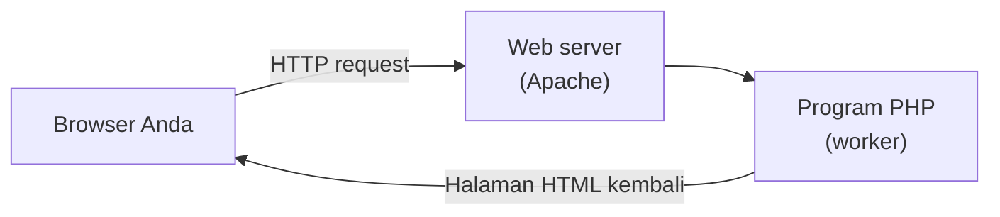
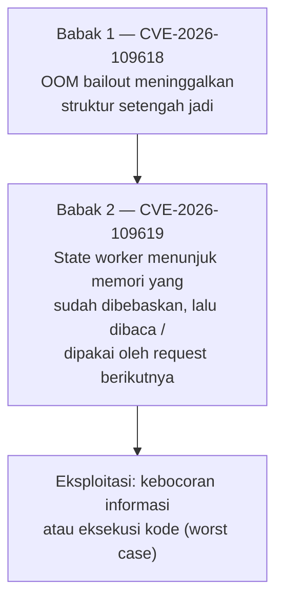

# Penjelasan CVE-2026-109618 & CVE-2026-109619 untuk Pemula

> Dokumen ini menjelaskan kedua kerentanan yang disimulasikan di lab ini untuk pembaca
> yang sedikit paham pemrograman, tetapi **belum** paham PHP, DevOps, atau keamanan jaringan.
> Istilah teknis dijelaskan saat pertama kali muncul, dan seluruhnya ada di [Glosarium](#7-glosarium).
> Panduan menjalankan demo ada di [`REPRODUCE.md`](./REPRODUCE.md).

---

## 1. Latar Belakang

### 1.1 Apa itu PHP dan di mana ia berjalan?

PHP adalah bahasa pemrograman yang paling sering dipakai untuk membuat situs web dinamis
(toko online, WordPress, dll.). Ketika Anda membuka sebuah situs PHP, yang terjadi kira-kira:

Kuncinya: satu **program PHP yang sama** dipakai berulang-ulang untuk melayani banyak
pengunjung. Program ini tinggal di server (bukan di komputer Anda), sering kali sebagai
bagian dari proses web server yang bernama **worker**. Satu worker melayani satu request
dalam satu waktu, lalu selesai, lalu melayani request berikutnya — berjam-jam, berhari-hari,
tanpa di-restart.

### 1.2 Apa itu memori dan "manajer memori"?

Setiap program menyimpan datanya di **memori (RAM)**: teks yang sedang diproses, hasil
hitungan, isi keranjang belanja, dan sebagainya. Memori bukan milik gratis — program
harus "meminjam" dari sistem operasi dan **mengembalikannya** setelah selesai, kalau tidak
memorinya habis dan program mati.

PHP punya bagian internal bernama **Zend Memory Manager (ZMM)** yang mengatur pinjam-meminjam
ini. Agar satu pengunjung nakal tidak menghabiskan memori server untuk semua orang, PHP
diberi **batas memori per request** (`memory_limit`). Di lab ini batasnya sengaja dibuat
sangat kecil: **2 MB per request**.

### 1.3 Apa itu CVE?

**CVE (Common Vulnerabilities and Exposures)** adalah nomor identitas resmi untuk sebuah
kerentanan keamanan yang sudah dikonfirmasi — seperti nomor polisi untuk kasus. Formatnya
`CVE-<tahun>-<nomor>`. Kedua kerentanan di dokumen ini ditemukan di mesin PHP internal
(zend) dan diperbaiki pada rilis patch Oktober 2026; lab ini membandingkan versi
**unfixed** (belum diperbaiki) dengan versi **fixed** (sudah diperbaiki).

---

## 2. Kerentanan #1 — CVE-2026-109618: OOM bailout yang meninggalkan setengah pekerjaan

### 2.1 Apa yang terjadi?

Ada kondisi bernama **OOM (Out of Memory)**: saat terjadi ketika sebuah request meminta
memori melebihi batas. Ketika itu PHP "menyerah" dengan cara yang disebut **bailout** —
secara teknis sebuah `zend_bailout()` yang melakukan `longjmp`, yaitu lompatan paksa
keluar dari kode yang sedang berjalan menuju prosedur pembersihan (shutdown), seperti
asisten yang langsung melompat ke pintu keluar begitu gudang penuh.

Masalahnya: **lompatan paksa itu bisa terjadi di tengah-tengah pekerjaan yang belum
selesai.** Struktur data internal request bisa berada dalam kondisi *terinisialisasi
sebagian* — setengah jadi — dan pada versi unfixed, **proses cleanup tidak melakukan
rollback utuh**: sisa setengah-jadi itu dibiarkan tertinggal.

### 2.2 Analogi: menulis formulir lalu listrik mati

Bayangkan petugas bank mengisi formulir data nasabah yang panjang, dengan aturan:
"formulir hanya berlaku kalau diisi penuh sekaligus."

1. Petugas mulai mengisi: nama ✓, alamat ✓, …
2. Di tengah pengisian, **listrik mati** (OOM bailout).
3. Prosedur darurat petugas hanya bilang: "evakuasi sekarang!" — tidak ada instruksi
   "musnahkan formulir setengah jadi itu."
4. **Versi unfixed:** formulir setengah jadi tetap tergeletak di meja. Petugas berikutnya
   (atau sistem verifikasi) bisa menemukan formulir itu dan **mengira data itu valid** —
   padahal setengahnya kosong. Data korup, keputusan salah.
5. **Versi fixed:** prosedur darurat menambahkan satu langkah: "sebelum evakuasi,
   musnahkan semua formulir yang belum selesai." Meja bersih; tidak ada yang salah kaprah.

### 2.3 Kenapa ini berbahaya?

- **Integritas data:** struktur internal yang setengah-jadi bisa dianggap valid oleh kode
  lain, menyebabkan perilaku tak terduga atau kegagalan yang sulit dilacak.
- **Kontinuitas worker:** karena worker tidak di-restart setelah OOM, kondisi kotor itu
  bisa bertahan dan memengaruhi request berikutnya (di sinilah ia bisa berantai dengan
  kerentanan kedua di bawah).
- **Vektor serangan:** penyerang cukup mengirim request yang sengaja memakan memori
  (misalnya upload besar atau string raksasa) untuk memicu bailout di titik yang
  menguntungkan mereka. Tidak perlu akses khusus — cukup HTTP biasa.

### 2.4 Demo di lab ini

Endpoint `lab/src/cve109618_oom.php` di setiap container:

1. Klik **Picu OOM** → request mengalokasi memori berulang sampai `memory_limit` 2 MB
   terlampaui → PHP melakukan bailout (fatal error di log).
2. Halaman menunjukkan **verdict**: pada versi unfixed state tertinggal
   `VULNERABLE PATTERN` (in_flight, setengah jadi); pada versi fixed `SAFE (rolled back)`.
3. Klik **Cek state** kapan pun untuk melihat kondisi terkini milik worker PID tersebut.

---

## 3. Kerentanan #2 — CVE-2026-109619: Use-After-Free di state worker

### 3.1 Apa yang terjadi?

**Use-After-Free (UAF)** adalah bug klasik keamanan memori: program **membaca/memakai
memori yang sudah dibebaskan** ("free" = mengembalikan memori ke sistem).

Dalam konteks ini, **state tingkat worker** (data yang hidup di proses worker, bukan di
satu request) masih menyimpan **referensi** (penunjuk/alamat) ke memori milik request
sebelumnya — memori yang sudah dibebaskan saat request itu selesai. Karena worker
**tidak di-restart**, request **berikutnya** yang dilayani worker yang sama bisa membaca
atau mengeksekusi referensi usang itu.

### 3.2 Analogi: kamar hotel dan kunci lama

Bayangkan resepsionis hotel yang menyimpan salinan kunci semua tamu di papan besar:

1. Tamu A check-out; kamarnya **dibebaskan** dan akan dibersihkan untuk tamu berikutnya.
2. **Versi unfixed:** resepsionis *lupa menghapus* salinan kunci Tamu A dari papan.
3. Tamu B check-in ke kamar yang sama. Resepsionis (atau siapa pun) melihat papan,
   mengambil "kunci Tamu A", dan membuka kamar — **isi kamarnya sekarang milik Tamu B**.
   Yang dibaca bukan lagi data Tamu A; itu **memori yang sudah dialihkan ke orang lain**.
4. **Versi fixed:** saat check-out, salinan kunci langsung dihapus dari papan. Papan
   hanya berisi kunci yang masih sah.

Perhatikan dua syarat yang membuat analogi ini nyata di lab:
worker **harus sama** (kami paksa dengan `MaxRequestWorkers 1`), dan worker **harus tidak
di-restart** (`MaxConnectionsPerChild 0`).

### 3.3 Kenapa ini berbahaya? (dan kenapa UAF termasuk bug paling serius)

UAF bukan sekadar "baca data basi". Memori yang sudah dibebaskan **bisa dipakai ulang
oleh data lain**. Artinya:

- **Kebocoran informasi:** request B bisa membaca sisa data request lain (fragmen keranjang
  belanja, token, isi sesi) yang kebetulan menempati alamat memori yang sama.
- **Eksekusi kode (worst case):** jika referensi usang di-*write* atau dieksekusi, penyerang
  yang mengendalikan isi memori tersebut bisa mengarahkan program menjalankan kode miliknya
  (Remote Code Execution). Kelas bug inilah yang secara historis memicu banyak eksploit
  serius di bahasa-bahasa dengan manajemen memori manual.

### 3.4 Demo di lab ini

Endpoint `lab/src/cve109619_uaf.php` di setiap container, dua langkah di worker PID yang sama:

1. **Stage & free (request A):** record dialokasikan lalu dibebaskan. Versi unfixed
   meninggalkan pointer "dangling" di registry worker; versi fixed menghapusnya.
2. **Baca ulang (request B):** request berikutnya di PID yang sama membaca registry.
   Unfixed → `USE AFTER FREE` (membaca payload usang); fixed → `SAFE`.

---

## 4. Bagaimana keduanya saling terkait

Kedua kerentanan adalah dua babak dari satu tema yang sama: **sisa-sisa request yang tidak
dibersihkan dengan benar, yang bertahan di dalam worker yang hidup terus**.

Kerentanan ini **spesifik PHP**: keduanya berada di mesin PHP (engine) itu sendiri —
Zend Memory Manager dan state worker level C internal — bukan di kode aplikasi.
Konsekuensinya:

- Semua aplikasi PHP (WordPress, Laravel, CMS apa pun) di versi rentan terekspos;
  penyerang tidak perlu tahu kode aplikasi target.
- Vektor serangan tetap **HTTP biasa**: cukup request yang sengaja memakan memori
  (upload besar, string raksasa) untuk memicu bailout di titik yang menguntungkan.
- Yang *tidak* spesifik PHP adalah polanya (OOM tanpa rollback, UAF lintas-request);
  pola serupa bisa ada di runtime lain, tetapi implementasi dan patch kedua CVE ini
  murni di PHP.

CVE-2026-109618 menyediakan **cara memicu** kondisi kotor; CVE-2026-109619 adalah
**kondisi kotor itu sendiri** yang bisa dieksploitasi lewat request berikutnya. Karena itu
demonstrasi di lab selalu memakai worker tunggal: tanpa determinisme PID, kedua babak
tidak akan tampak berurutan.

---

## 5. Solusi & perbaikan

### 5.1 Perbaikan di sisi PHP (patch Oktober 2026)

1. **Rollback utuh saat bailout (CVE-2026-109618):** prosedur cleanup setelah `zend_bailout`
   dijamin menjalankan pembersihan menyeluruh — semua struktur yang terinisialisasi sebagian
   di-rollback ke kondisi bersih, tidak ada state setengah-jadi yang tertinggal.
2. **Invalidasi referensi saat free (CVE-2026-109619):** ketika memori request dibebaskan,
   **semua** referensi ke memori itu di state worker/global ikut dihapus atau ditandai
   tidak sah, sehingga request berikutnya tidak mungkin membaca memori usang.

### 5.2 Prinsip umum yang bisa dibawa pulang

| Prinsip | Artinya |
| :--- | :--- |
| *Fail-safe cleanup* | Kegagalan apa pun (crash, OOM, timeout) harus meninggalkan sistem dalam kondisi bersih, bukan setengah jadi. |
| *Ownership & lifetime* | Setiap alokasi memori punya pemilik dan rentang hidup yang jelas; saat hidupnya berakhir, semua penunjuk kepadanya harus dimatikan juga. |
| *Determinisme untuk pengujian* | Bug lintas-request hanya terlihat kalau request berurutan masuk ke tempat yang sama — makanya lab ini mengunci worker jadi satu. |
| *Defense in depth* | Batas resource (`memory_limit`, limit container) bukan hanya soal efisiensi; ia juga menentukan **titik di mana** kegagalan terjadi, dan itu harus selalu titik yang aman. |

### 5.3 Apa yang bisa dilakukan pengguna/administrator?

- **Perbarui PHP** ke versi patched (rilis Oktober 2026) — inilah solusi utama; tidak ada
  workaround kode aplikasi yang menggantikan patch di level mesin runtime.
- Kurangi permukaan serangan yang memicu OOM: batasi ukuran upload, batasi kompleksitas
  input yang diproses per request.
- Pantau log fatal error `Allowed memory size` — lonjakan tiba-tiba bisa menjadi tanda
  upaya pemicuan OOM.

---

## 6. Suplemen: catatan tentang simulasi di lab ini

Demi kejujuran akademik, perlu ditegaskan bagaimana demo ini bekerja:

1. **Image resmi `php:*-apache` tidak memuat perbedaan patch internal Zend** antara tag
   8.5.11/8.5.12 dst. Perilaku *unfixed* vs *fixed* pada kedua endpoint **diemulasi** dari
   environment variable `LAB_PHP_STATUS` yang diset saat build Docker. Yang **nyata** dan
   tidak disimulasikan: fatal error OOM (zend_bailout) memang terjadi karena
   `memory_limit = 2M`; determinisme worker PID memang dijamin `MaxRequestWorkers 1`;
   isolasi memori container 48 MB memang aktif.
2. State "internal" di demo dimodelkan sebagai **file state per worker PID**
   (`/tmp/php_sessions/lab_oom_state_<pid>.json` dan `lab_worker_<pid>.json`) — ini
   menggantikan memori proses yang tidak bisa diintip langsung dari PHP-level, dan
   sekaligus membuat bukti demo **bisa ditampilkan** di browser.
3. Konfigurasi lab yang mendukung demo (jangan diubah sembarangan):
   - `lab/config/php.ini` → `memory_limit = 2M`
   - `lab/config/mpm_prefork.conf` → `MaxRequestWorkers 1`, `MaxConnectionsPerChild 0`
   - `lab/docker-compose.yml` → `mem_limit: 48m`, `memswap_limit: 48m`

### 6.1 Daftar periksa presentasi (2 menit per CVE)

- [ ] Tunjukkan `mise run lab:check` — 8 container hidup, badge UNFIXED/FIXED, PID worker.
- [ ] Buka `cve109618_oom.php` berdampingan → **Picu OOM** → fatal sama, verdict berbeda.
- [ ] Buka `cve109619_uaf.php` berdampingan → **Stage** lalu **Baca** → UAF vs SAFE.
- [ ] Tekankan: syarat kuncinya *worker yang sama, tidak di-restart* (Langkah 0 di `mise run lab:demo`).

---

## 7. Glosarium

| Istilah | Artinya (versi awam) |
| :--- | :--- |
| **Request** | Satu kunjungan: browser meminta halaman, server memproses, lalu menjawab. |
| **Worker** | Proses di server yang melayani request satu per satu. Ibarat kasir: satu kasir, banyak antrean pelanggan bergantian. |
| **Memori (RAM)** | "Meja kerja" program; datanya diletakkan di sini selama diproses. |
| **Alokasi / free** | Meminjam meja kerja / mengembalikannya. Lupa mengembalikan = kebocoran memori; memakai meja yang sudah dikembalikan = use-after-free. |
| **OOM (Out of Memory)** | Kondisi ketika permintaan meja kerja melebihi jatah, dan program dipaksa berhenti. |
| **zend_bailout / longjmp** | Mekanisme "lompat paksa ke pintu darurat" PHP saat OOM — tidak bisa ditangkap dengan try/catch biasa. |
| **Rollback** | Membatalkan pekerjaan setengah jadi sampai kondisi bersih seperti sebelum dimulai. |
| **Referensi / pointer** | Penunjuk alamat ke suatu data di memori — seperti alamat rumah, bukan rumahnya. |
| **Use-After-Free (UAF)** | Memakai penunjuk ke data yang sudah dibebaskan — seperti membuka rumah orang lain dengan kunci lama. |
| **State** | Data yang tersimpan dan bertahan antar peristiwa; state worker bertahan antar request. |
| **Docker / container** | Kemasan terisolasi untuk menjalankan program; limit memori container membatasi total RAM yang boleh dipakai. |
| **memory_limit** | Batas memori per request pada PHP (di lab ini: 2 MB). |
| **CVE** | Nomor identitas resmi sebuah kerentanan keamanan yang sudah dikonfirmasi. |
| **Patch** | Pembaruan perangkat lunak yang memperbaiki kerentanan. |
